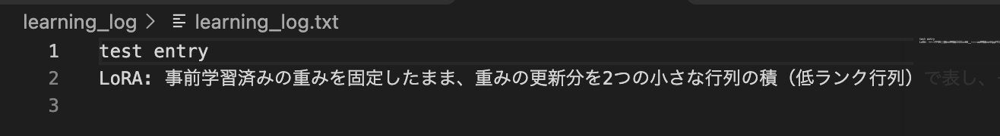

# 第3回 解答

## 演習

- 第1回（素のLLM）とエージェントの回答の違い： Before providing an answer, the agent can invoke tools—such as a glossary or lecture materials
- `--trace` で見えたツール呼び出し（ツール名と引数）：`search_glossary({'query': 'LoRA'})`
or, for questions concerning lecture content:
`get_lecture_summary({'lecture': 2})`
- 1つの質問での LLM 呼び出し回数（`requests`）： there are typically two LLM calls: one for the model to select the appropriate tool, and another to generate a response based on the tool's output (resulting in `requests=2`).
- 追加したツールと、docstring に書いた説明： I implemented `make_quiz(lecture: int)`. This function retrieves terms from the glossary for a specified lecture, selects one at random, and returns a review question along with its definition in JSON format. If no relevant terms are found, it returns an error message.

## 宿題

- 取り組んだレベル： 基礎, 実装, 発展 (a)
#### 基礎
- やったこと：I changed the INSTRUCTIONS (added: `- 確認問題を求められたら、まず講義の要点を短く説明し、その後に問題を1問出す。`) and asked the same question before and after the change: "第2回の内容から確認問題を1問出して".
- `--trace` で見えたツール呼び出し（ツール名と引数）：
  - Before: `make_quiz({'lecture': 2})`
  - After: `get_lecture_summary({'lecture': 2})` → `make_quiz({'lecture': 2})`

  Before the change there were 2 LLM calls (choose `make_quiz`, then write the answer, `requests=2`). After the change there were 3 LLM calls (call `get_lecture_summary`, then `make_quiz`, then write the answer, `requests=3`).
- 結果：
  | | Before | After |
  | --- | ---: | ---: |
  | LLM calls (`requests`) | 2 | 3 |
  | Tool calls (`tool_calls`) | 1 | 2 |
  | Input tokens | 990 | 2599 |
  | Output tokens | 80 | 169 |
  | Cost, $ | 0.0004970 | 0.0012022 |

- 気づき・疑問： The number of output tokens has doubled, and tool calls have increased by 1 because the new rule made the agent call get_lecture_summary before make_quiz.

#### 実装: 
- やったこと： I created a save_learning_log in tools. after that checked throw `--list-tools` that tool is in the list. 
- 結果： the command `uv run python -m app.agent --trace "log"` runs function and in console appeares the question `«保存しますか？ [y/N]»`. If the user approves the request (y), the learning log is saved. If the user declines, the save operation is not executed and no log file is created.

- 気づき・疑問：You need to decide in advance on the path to the folder where logs will be saved.

#### 発展（Advanced A: Google ADK）
- やったこと： I integrated Google ADK in the `adk_agent` folder, passed the same tools during initialization, and made the exact same request.
- 結果： I received a comprehensive response with an explanation. The ADK CLI did not display tool calls in this run, and there are no links to the lecture materials. In comparison, the Pydantic AI agent displayed a search_glossary tool call and included a reference to Lecture 2 in its answer.

  | | Pydantic AI (`app.agent`) | Google ADK (`adk_agent`) |
  | --- | --- | --- |
  | Command | `uv run python -m app.agent --trace "What is the difference between LoRA and QLoRA?"` | `uv run adk run adk_agent` → same question in chat |
  | Model | `gemini-3.5-flash-lite` | `gemini-3.5-flash-lite` |
  | Tool calls | `search_glossary({'query': 'LoRA'})`, `search_glossary({'query': 'QLoRA'})` | not shown in CLI |
  | LLM calls (`requests`) | 2 | not shown |
  | Tool calls (`tool_calls`) | 2 | not shown |
  | Input / output tokens | 1522 / 204 | not shown |
  | Cost, $ | 0.0009666 | not shown |
  | Lecture reference | （関連する回：第2回） | none |
  | Opening line | The main difference between LoRA and QLoRA is how the base model weights are handled. | According to the course glossary, the difference between LoRA and QLoRA is as follows. |
  | LoRA | Pretrained weights are frozen; the weight update is represented as a product of small low-rank matrices, and only that part is trained (PEFT). Greatly reduces trainable parameters. | Pretrained weights are frozen; the weight update is represented by two small low-rank matrices, and only those are trained (PEFT). Few trainable parameters, small adapter file. |
  | QLoRA | Based on LoRA, but the base model weights are also quantized to 4 bits or similar. Drastically reduces memory, so larger models can be trained efficiently on limited GPUs. | Base model weights are quantized to 4 bits or similar to save memory, then trained with LoRA. Larger models can be handled with relatively small GPU memory. |

- 気づき・疑問： Integrating it is much simpler than building your own implementation. The results turned out to be comparable, but the behavior and observability of the calls differed.